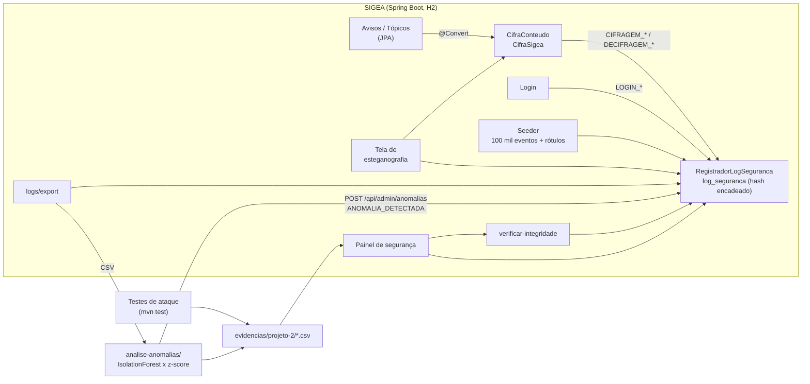

# Projeto 2: sistema criptográfico e análise de ataques no SIGEA

Cibersegurança Aplicada a Dados e IA, CESAR School, Prof.ª Renatta Nigro.

Integrantes: _preencher_

Branch: `feat/projeto-2`. Todos os números deste relatório saem dos CSVs desta pasta,
gerados por execução real; o arquivo de origem aparece ao lado de cada um. Quando um
número é uma contagem feita sobre um CSV, isso está dito.

## 1. Resumo

Implementamos no SIGEA, uma plataforma de ensino em Spring Boot já existente:

- **CifraSigea**, cifra de bloco própria (rede de substituição e permutação, 16 bytes,
  chave de 256 bits, subchaves que mudam a cada mensagem). Ela cifra o conteúdo de
  avisos e tópicos no banco.
- **Três ataques** contra a cifra própria e contra o AES-256-GCM: força bruta,
  diferencial (efeito avalanche) e estatístico.
- **Esteganografia LSB em PNG**, com uma tela que esconde o texto cifrado de um aviso
  numa imagem e o recupera depois.
- **Log de segurança com hash encadeado**, 100 mil eventos sintéticos rotulados e um
  endpoint que aponta a linha adulterada.
- **Detecção de anomalias** em Python (IsolationForest e z-score), medida contra a
  verdade conhecida dos rótulos.
- **Painel de segurança** com seis painéis, ao vivo e a partir dos CSVs.

Principais resultados:

- A avalanche da CifraSigea chega a 50% na 2ª rodada; o AES chega na 3ª.
- Os dois textos cifrados passam no teste de uniformidade, com entropia perto de 8 bits
  por byte.
- A esteganografia fica acima de 51 dB de PSNR mesmo com a imagem cheia, mas é
  detectada pelo qui-quadrado no trecho embutido.
- O z-score, o modelo mais simples, superou o IsolationForest em todas as métricas.

## 2. Arquitetura



A cifra fica em `dominio-principal` (pacote `dev.com.sigea.dominio.cripto`, só JDK, sem
Spring). A integração com o banco e o log fica em `infraestrutura`, e os endpoints, todos
restritos a `ADMINISTRADOR`, ficam em `apresentacao-backend`.

## 3. A CifraSigea

### 3.1 Especificação

| Parâmetro | Valor |
|---|---|
| Bloco | 16 bytes |
| Chave mestra | 256 bits |
| Nonce | 12 bytes do `SecureRandom`, novo a cada mensagem |
| Rodadas | parâmetro do construtor, padrão 10 |
| Padding | PKCS#7 |
| Modo | CBC, com IV derivado do nonce |
| Saída | `v1:` + Base64(nonce ‖ texto cifrado) |

**Chave dinâmica.** As subchaves são K_r = SHA-256(chave mestra ‖ nonce ‖ r)[0..15]. Como
o nonce entra no escalonamento, as subchaves mudam a cada mensagem mesmo com a chave
mestra fixa. Um teste cifra o mesmo texto duas vezes com a mesma chave e confirma que os
textos cifrados diferem.

**S-box dependente da chave.** É uma permutação de 0..255 por Fisher-Yates, alimentada por
SHA-256(chave mestra ‖ contador). A inversa é gerada junto, para a decifragem.

**Rodada**, nesta ordem:

1. AddRoundKey (XOR com K_r).
2. SubBytes (S-box): a confusão.
3. Camada de difusão linear (MixColumns MDS).
4. Permutação das posições dos bytes, mais rotação de bits por posição.

### 3.2 Evolução da difusão: medido antes de mudar

O brief especificava como passo 3 uma "cadeia dupla": duas passadas de XOR, uma para a
frente e outra para trás. Medimos essa versão antes de trocá-la e mantivemos as três
versões disponíveis para comparação (`difusao-comparacao.csv`, 20.000 pares, 10 rodadas,
bloco único):

| Difusão | Permutação | Média | Mínimo | Pares abaixo de 32 bits |
|---|---|---|---|---|
| Cadeia dupla (brief) | livre | 49,60% | 1 bit | 92 (0,46%) |
| MixColumns MDS | livre | 49,96% | 11 bits | 12 (0,06%) |
| MixColumns MDS | espalha colunas (atual) | 50,02% | 41 bits | 0 |

A média de 49,6% escondia uma cauda: pares em que um bit virado alterava 1 único bit do
texto cifrado depois de 10 rodadas. A cadeia dupla é linear e tem diferenças que ela
própria cancela. Por isso a trocamos pela MixColumns, que tem número de ramificação
máximo.

Ainda sobraram 12 pares ruins, e diagnosticamos a causa em `cauda-diagnostico.csv`. Com a
permutação livre, algumas chaves devolvem os 4 bytes de uma coluna para a mesma coluna, e
a diferença fica presa nessa coluna em todas as rodadas: os 10 pares desse grupo ficaram
todos abaixo de 32 bits, com média de 12,19%. A qualidade da S-box não explica a cauda.
A correção força a permutação a espalhar cada coluna pelas quatro. A decisão veio do
diagnóstico, não de ajustar até o número melhorar, e a versão antiga continua reproduzível.

### 3.3 No app

O conteúdo de avisos e tópicos vai para o banco cifrado. Os converters JPA
(`ConteudoCifradoAvisoConverter` e `ConteudoCifradoTopicoConverter`, no padrão do
`CpfCryptoConverter`) delegam para `CifraConteudo`, que também grava `CIFRAGEM_*` e
`DECIFRAGEM_*` no log encadeado.

A chave é derivada de `CPF_ENCRYPTION_KEY` com separação de domínio, então não exige um
segredo novo no deploy. Linhas antigas em texto claro são cifradas na subida
(`RecifragemConteudoLegado`). O AES-256-GCM do CPF continua como baseline de comparação.

## 4. Ataques

Cada ataque roda contra a CifraSigea e contra o AES-256-GCM do JCE.

### 4.1 Força bruta (`forca-bruta.csv`, `forca-bruta-extrapolacao.csv`)

A busca exaustiva real usou chaves com 8, 12, 16, 20 e 24 bits desconhecidos e um par
texto claro/texto cifrado conhecido como oráculo. Os dois lados acharam a chave certa em
todos os tamanhos.

| Bits desconhecidos | Tentativas | CifraSigea (s) | AES-256-GCM (s) |
|---|---|---|---|
| 8 | 256 | 0,009 | 0,003 |
| 12 | 4.096 | 0,201 | 0,059 |
| 16 | 65.536 | 2,240 | 0,610 |
| 20 | 1.048.576 | 47,867 | 4,741 |
| 24 | 16.777.216 | 472,522 | 46,394 |

O tempo dobra a cada bit. O ajuste exponencial em log₂ dá inclinação de 0,98 para a
CifraSigea (R² = 0,998) e 0,87 para o AES (R² = 0,993).

Para os 2^256 = 1,16 × 10^77 candidatos da chave inteira:
- a 10^12 chaves por segundo, a varredura levaria 3,67 × 10^57 anos;
- na taxa medida da CifraSigea (35.506 chaves/s com 24 bits), levaria 1,03 × 10^65 anos.

Na medição de 24 bits, a CifraSigea testou chaves cerca de 10 vezes mais devagar que o
AES (35.506 contra 361.628 chaves/s), porque cada candidata gera de novo a S-box e a
permutação. Isso não é segurança: um
atacante pagaria esse custo uma vez por chave, assim como nós.

A taxa varia entre execuções na mesma máquina, e o AES já variou perto de 2x. Por isso só
comparamos as duas cifras dentro da mesma execução.

### 4.2 Diferencial: efeito avalanche (`avalanche.csv`)

Cada medida usa 5.000 pares por rodada, na função de bloco: viramos 1 bit e contamos
quantos dos 128 bits do bloco cifrado mudaram.

| Rodadas | CifraSigea, texto | AES, texto | CifraSigea, chave | AES, chave |
|---|---|---|---|---|
| 1 | 12,61% | 3,15% | 49,88% | 1,92% |
| 2 | 50,10% | 12,51% | 49,95% | 10,05% |
| 3 | 49,93% | 50,12% | 50,08% | 32,79% |
| 4 | 50,05% | 50,08% | 49,97% | 50,07% |
| 10 | 50,01% (σ 4,43) | 50,02% | 50,10% | 49,99% |
| 14 (AES) | — | 49,91% | — | — |

- A avalanche de texto da CifraSigea satura na 2ª rodada, e a do AES na 3ª. Com 10
  rodadas, o mínimo observado foi de 44 bits em 128.
- A avalanche de chave da CifraSigea satura já na 1ª rodada. **Isso não é sinal de
  força**: virar um bit da chave mestra gera de novo a S-box e a permutação inteiras.
- A curva do AES por rodada vem de uma implementação de teste validada contra o vetor C.3
  do FIPS-197 e contra o JCE, porque o JCE só oferece as 14 rodadas.

**O modo de operação importa** (`avalanche-modo.csv`, 2.000 pares, mensagem de 10 blocos):
- No CBC, virar um bit no 1º bloco muda 50,03% do texto cifrado inteiro; virar no último
  bloco muda só 9,09%, porque o CBC só propaga para a frente.
- No GCM, virar um bit do texto claro vira exatamente 1 bit do corpo cifrado (0,08%): o
  GCM é um modo de fluxo. A difusão fica toda na tag (50,03%).

### 4.3 Estatístico (`estatistico.csv`, `frequencia-bytes.csv`)

O texto de teste reúne 21 arquivos `.md` em português versionados no repositório,
125.186 bytes ao todo. Cada parágrafo é cifrado como uma mensagem separada, com nonce
próprio: 696 mensagens (`corpus-estatistico.csv`).

| Fonte | Bytes | Qui-quadrado (255 g.l.) | Valor-p | Entropia (bits/byte) | Índice de coincidência | Blocos de 16 repetidos |
|---|---|---|---|---|---|---|
| Texto claro | 125.186 | 1.472.148,4 | 0 | 5,02 | 0,0498 | 366 de 7.824 |
| CifraSigea (CBC) | 130.928 | 230,4 | 0,864 | 7,9987 | 0,00391 | 0 |
| AES-256-GCM | 136.322 | 259,9 | 0,403 | 7,9986 | 0,00391 | 0 |

O índice de coincidência dos dois textos cifrados fica em 1/256 ≈ 0,00391, o valor de
bytes uniformes. O do português é 0,0498.

**10 KB da letra "A":**
- Em CBC e em GCM, nenhum bloco de 16 bytes se repetiu (0 de 641).
- No ECB emulado, com a mesma cifra, 639 de 640 blocos se repetiram e a entropia caiu
  para 4,0 bits por byte, nas duas cifras.

É a demonstração de por que o modo de operação importa tanto quanto a cifra.

**Um valor-p não é veredito.** Na linha "10 KB de A" da CifraSigea em CBC, o valor-p foi
0,046 com o texto de teste em 696 mensagens, 0,480 quando ele passou a 702 e de novo 0,046
quando voltou a 696. A cifra era a mesma. O gerador aleatório do teste é consumido antes
pelo texto de teste, então o número de mensagens decide a chave e os nonces sorteados para
essa linha. Para uma fonte uniforme, um valor-p abaixo de 0,05 aparece em 5% das amostras.
As três gerações estão no histórico do git.

## 5. Esteganografia (`estego.csv`)

O método é LSB de 1 bit nos canais R, G e B, sem tocar no alfa, com 4 bytes de cabeçalho
para o tamanho. A capacidade é largura × altura × 3 / 8 bytes, menos o cabeçalho.

Só PNG é aceito, validado pela assinatura do arquivo. JPG é recusado com erro explícito,
porque a compressão com perda reescreve os bits baixos. A tela tem allowlist própria e
não herda a do upload de anexos, que aceita jpg e gif.

Medimos 44 capas, todos os PNGs versionados sem duplicatas, com quatro níveis de
ocupação. As contagens abaixo foram feitas sobre o CSV:

| Ocupação | PSNR (mín.–máx.) | Trecho embutido com p > 0,95 | Mesmo trecho na capa limpa com p < 0,05 | Imagem inteira com p > 0,95 |
|---|---|---|---|---|
| 1% | 71,07–71,26 dB | 7 de 34 (10 sem teste possível) | 34 de 34 | 0 de 44 |
| 10% | 61,12–61,16 dB | 40 de 44 | 44 de 44 | 0 de 44 |
| 50% | 54,14–54,16 dB | 44 de 44 | 44 de 44 | 0 de 44 |
| 100% | 51,13–51,15 dB | 43 de 44 | 44 de 44 | 43 de 44 |

- **Invisível ao olho:** o PSNR ficou acima de 40 dB em todos os casos, até com a imagem
  cheia.
- **Detectável pela estatística:** é o ataque qui-quadrado de Westfeld e Pfitzmann, com a
  leitura inversa da Fase 2. Valor-p perto de 1 significa que os pares de valores (2k,
  2k+1) estão igualados, que é a marca do LSB.
- **Onde procurar faz diferença:** o embutimento é sequencial. Quem analisa a imagem
  inteira só vê a marca com 100% de ocupação; quem varre do começo a vê já com 10%.
- **Ressalva:** as capas são capturas de tela, com cor chapada, o caso mais fácil para o
  detector. O resultado não vale como estimativa para fotos.

Na tela (`esteganografia.html`), o payload é a coluna `avisos.conteudo` como está no
banco, já cifrada pela CifraSigea. A ordem fica à vista: cifrar antes de esconder. Um
teste de integração faz a ida e volta pelo endpoint, recupera o texto original e exige
PSNR acima de 40 dB.

## 6. Log encadeado e volume de eventos

A tabela `log_seguranca` (migration V28) é gravada só por `RegistradorLogSeguranca`. O
`hash_atual` é o SHA-256 de uma serialização canônica de todas as colunas mais o
`hash_anterior`; o primeiro registro usa 64 zeros. O endpoint
`/api/admin/auditoria/verificar-integridade` percorre a cadeia e devolve o primeiro
`log_id` corrompido.

**Seeder** (`seeder-resumo.csv`, `seeder-tipos.csv`, `seeder-horas.csv`):
- 100.000 eventos em 14 dias, de 617 usuários sintéticos;
- picos em horário de aula, 98,36% de sucessos;
- 50 incidentes injetados em 5 cenários, que somam 2.899 eventos rotulados (2,90%);
- os rótulos ficam numa tabela separada (`rotulo_evento_experimental`), que o detector só
  lê na avaliação.

Os parâmetros do seeder foram fixados antes de qualquer detector rodar. A mesma semente
gera a mesma tabela, hash por hash (`seeder-volume.csv`).

**Critério de aceite.** Editamos uma linha pelo console H2 do app real, e o endpoint
apontou exatamente aquele `log_id` (`fase4-demonstracao-console.txt`). O teste
`LogSegurancaIntegracaoTest` repete isso para cada coluna, em três posições da cadeia.

**Eventos reais.** O app emite de verdade:
- login (sucesso e falha);
- cifragem e decifragem do conteúdo;
- esteganografia;
- anomalias detectadas e violação de integridade.

Só `ATAQUE_EXECUTADO` existe apenas no volume sintético, porque os ataques rodam como
testes.

## 7. Detecção de anomalias (`deteccao.csv`)

Os eventos foram agregados em janelas de 5 minutos por usuário, ou por IP quando não há
usuário. Cada uma das cinco anomalias do enunciado tem ao menos uma feature:

| Anomalia do enunciado | Features |
|---|---|
| Tentativas de autenticação incomuns | `n_tentativas_login`, `n_falhas_login`, `taxa_falha` |
| Falhas de descriptografia frequentes | `n_falhas_decifragem` |
| Alterações inesperadas em arquivos | `n_violacoes_integridade` |
| Padrões atípicos de acesso | `n_recursos_distintos`, `raridade_hora` |
| Geração incomum de eventos | `n_eventos`, `intervalo_medio_entre_eventos`, `desvio_intervalo` |

São 22.465 janelas, das quais 85 contêm evento de incidente (0,38%). Os dois modelos
usaram configuração padrão, sem ajuste contra os rótulos:
- IsolationForest com `contamination='auto'` e semente fixa;
- z-score que alerta quando qualquer feature passa de 3 desvios.

| Modelo | Janelas marcadas | Precisão | Recall | F1 | Taxa de falso positivo | ROC-AUC | Precisão média | Incidentes encontrados |
|---|---|---|---|---|---|---|---|---|
| IsolationForest | 1.870 | 0,0412 | 0,9059 | 0,0788 | 8,01% | 0,9555 | 0,4165 | 45 de 50 |
| z-score | 1.565 | 0,0530 | 0,9765 | 0,1006 | 6,62% | 0,9912 | 0,8533 | 50 de 50 |

**Leitura crítica:**

- **O modelo mais simples ganhou em tudo.** O z-score teve mais recall e menos falsos
  positivos, e a precisão média dele é o dobro da do IsolationForest.
- **O ponto cego do IsolationForest é a violação de integridade:** só 5 dos 10
  incidentes foram achados. `INTEGRIDADE_VIOLADA` nunca ocorre em uso normal, então
  `n_violacoes_integridade` é zero em quase toda a amostra de treino de cada árvore. Ela
  variou em só 10 das 100 árvores e recebeu corte em 6
  (`deteccao-isolation-forest-arvores.csv`). O z-score pega esses incidentes porque
  qualquer valor acima de zero passa de 3 desvios.
- **A precisão é baixa para os dois** (4% a 5%), com base de 0,38%. Os falsos positivos
  do z-score vêm de comportamento normal mas raro (`deteccao-zscore-feature-dominante.csv`):
  - `taxa_falha`: 637 (numa janela com poucos eventos, uma única senha errada já eleva
    muito a taxa);
  - `raridade_hora`: 419;
  - `desvio_intervalo`: 370.

  O limiar não foi mexido para melhorar esses números.
- **Retreinar sobre o log ao vivo muda o resultado, e por isso a demonstração usa a
  entrada congelada.** O script treina os modelos a cada execução. Rodado sobre o log ao
  vivo, ele treina sobre um conjunto que passa a incluir os eventos da própria
  demonstração (logins, cifragens, verificações), com o horário real dela, e a fronteira
  de decisão do IsolationForest se desloca. Em ensaios de 16/11/2026, com 100.007
  eventos, ele marcou 1.986 janelas numa execução e 1.936 noutra, feita uma hora depois,
  contra 1.870 aqui; o z-score marcou 1.566 nas duas. Os números deste relatório vêm da
  entrada congelada, versionada em `deteccao-entrada-eventos.csv.gz` e
  `deteccao-entrada-rotulos.csv.gz`; descomprimidas, elas têm os SHA-256 registrados em
  `deteccao-entrada.csv`. A demonstração roda sobre essa entrada e reproduz
  `deteccao.csv` byte a byte (`demo-apresentacao-saida.txt`, passo 6).

O script devolve as janelas marcadas ao SIGEA por `POST /api/admin/anomalias`; elas
viram `ANOMALIA_DETECTADA` no log e aparecem no painel (3.435 no ensaio: 1.870 + 1.565).

## 8. Painel de segurança e telas

`dashboard-seguranca.html`, só para administrador:

| Painel | Origem |
|---|---|
| Eventos por hora | Ao vivo, do log (sem `ANOMALIA_DETECTADA`, cujo horário é o do envio em lote) |
| Anomalias detectadas, com score e usuário | Ao vivo, as 50 de maior score de cada modelo |
| Avalanche por rodada, CifraSigea x AES | Medido: `avalanche.csv` |
| Distribuição de bytes, texto claro x os dois cifrados | Medido: `frequencia-bytes.csv` |
| Status da cadeia de integridade | Ao vivo: `verificar-integridade` |
| Precisão, recall e F1 do detector | Medido: `deteccao.csv` |

Os painéis medidos leem os CSVs como estão; um teste confere que o conteúdo servido é
igual ao arquivo versionado.

No painel e na tela de esteganografia, nenhum dado do servidor passa por `innerHTML`, e o
Chart.js é carregado com SRI. As telas de avisos, que já existiam, tinham um XSS
armazenado, encontrado e corrigido durante este projeto (seção 9, achado 7).

## 9. Fraquezas encontradas (Parte 4)

Documentadas, e não corrigidas, quando corrigir apagaria o achado:

1. **CBC sem autenticação: maleabilidade demonstrada no app.** Trocamos um caractere no
   1º bloco do texto cifrado de um aviso pelo console H2. O aviso abriu com o 1º bloco
   embaralhado e bits trocados no 2º ("Calculo I" virou "Calculo e" no ensaio), **sem nenhum
   erro e sem `DECIFRAGEM_FALHA`** (`demo-apresentacao-saida.txt`, passo 3; teste
   `adulteracaoNoMeioPassaCalada`). Só a adulteração que quebra o formato ou o padding é
   detectada (passo 4). No CPF, o AES-GCM recusaria as duas pela tag.
2. **Padding oracle.** Pelo mesmo motivo, a cifra é vulnerável a ataque de padding oracle
   onde o sistema revela se o padding era válido. O endpoint de extração da
   esteganografia diz o motivo da falha de decifragem. Ele é restrito a administrador,
   que já lê todo o conteúdo, mas mostra o tipo de canal que o ataque exige.
3. **Chave do conteúdo derivada do segredo do CPF.** Evita um segredo novo no deploy,
   mas quem tiver `CPF_ENCRYPTION_KEY` abre os dois.
4. **Hash do log sem chave.** Quem escreve no banco pode recalcular todos os hashes a
   partir da linha alterada, e truncar o fim do log não quebra elo nenhum. Só uma âncora
   externa (o `hashFinal` guardado fora do banco) denuncia os dois casos
   (`CadeiaHashLogTest.limitesSemAncora`). A correção seria HMAC com chave fora do banco
   ou publicação periódica do `hashFinal`.
5. **LSB sequencial e por substituição.** O payload ocupa o começo da imagem e iguala os
   pares de valores, que é exatamente o que o qui-quadrado detecta (seção 5). Embutir em
   posições sorteadas por chave e usar LSB matching (±1) dificultariam a detecção.
6. **Velocidade da CifraSigea.** Na medição de 24 bits, ela foi cerca de 10 vezes mais
   lenta que o AES por chave testada (seção 4.1), um custo de desempenho sem ganho de
   segurança.
7. **XSS armazenado nas telas de avisos: encontrado durante o Projeto 2 e corrigido.**
   Ao ligar a CifraSigea ao conteúdo dos avisos, notamos que as telas de avisos de admin,
   professor e aluno (`avisos-admin.js`, `avisos-professor.js`, `avisos-aluno.js`) montavam
   cada card com `innerHTML` sem escapar título, conteúdo, escopo e data.
   - **O que era explorável:** `POST /api/avisos` aceita qualquer usuário autenticado,
     inclusive um aluno que acabou de se cadastrar. No teste com o código antigo, um aluno
     publicou avisos com `` no conteúdo e
     `` no título, e o código executou nas três telas, no
     navegador de quem abria a página, administrador incluído. O `<script>alert(1)</script>`
     também virava HTML, mas não executava, porque o navegador não roda script inserido
     por `innerHTML`.
   - **O que mudou:** as três telas passam título, conteúdo, escopo e data pelo mesmo
     `escapeHtml` que o projeto já usa nas outras telas (a mitigação da V-13 do Projeto 1).
     O backend não mudou. Com o código novo, os mesmos avisos aparecem como texto nas
     três telas, sem nenhuma chamada a `alert` e sem elemento `` injetado.
   - **O que não muda:** cifrar o conteúdo em repouso não protege contra isso, porque o
     texto é decifrado antes de chegar à tela. A permissão de qualquer usuário publicar
     aviso continua igual; é uma questão de autorização, fora do escopo deste brief.

## 10. Desvios do brief e decisões

| Decisão | Por quê |
|---|---|
| Difusão trocada de cadeia dupla para MixColumns MDS, e permutação que espalha colunas | Medição e diagnóstico (seção 3.2), com as três versões preservadas para comparação |
| Hash do log cobre também `ip` e `detalhe` | Com a fórmula do brief, editar essas colunas passaria sem detecção, o que contradiz o critério de aceite |
| Texto do ataque estatístico = `.md` versionados | O seed de avisos e tópicos que o brief citava não existe; nenhuma migration insere neles |
| Chave do conteúdo derivada de `CPF_ENCRYPTION_KEY` | Não exigir segredo novo no Railway (ver fraqueza 3) |
| `ATAQUE_EXECUTADO` só no volume sintético | Os ataques rodam como testes, não no app |

## 11. Rastreabilidade

| Requisito do enunciado | Onde | Evidência |
|---|---|---|
| Criptografia simétrica com chave dinâmica | `CifraSigea`, `EscalonadorChaves` | Teste de textos cifrados distintos para o mesmo texto |
| Chave secreta influencia a cifragem | AddRoundKey e S-box dependentes da chave | Avalanche de chave, `avalanche.csv` |
| XOR, substituição, permutação, blocos | AddRoundKey, SubBytes, Permute; 16 bytes, CBC, PKCS#7 | Código e seção 3 |
| Difusão e confusão | MixColumns e Permute / SubBytes | `avalanche.csv`, `difusao-comparacao.csv` |
| Ataque de força bruta | `AtaqueForcaBrutaTest` | `forca-bruta.csv`, `forca-bruta-extrapolacao.csv` |
| Ataque diferencial e efeito avalanche | `AtaqueDiferencialTest` | `avalanche.csv`, `avalanche-histograma.csv`, `avalanche-modo.csv` |
| Ataque estatístico e distribuição | `AtaqueEstatisticoTest` | `estatistico.csv`, `frequencia-bytes.csv` |
| Esteganografia em imagens | `EsteganografiaLSB`, tela de esteganografia | `estego.csv`, `estego-curva.csv` |
| Grandes volumes de eventos | `log_seguranca` e seeder | `seeder-*.csv` (100 mil eventos) |
| Logs das operações criptográficas | `CIFRAGEM_*`, `DECIFRAGEM_*`, `ESTEGO_*` emitidos pelo app | `demo-apresentacao-saida.txt` |
| Tentativas de acesso e falhas de autenticação | `LOGIN_*` | `demo-apresentacao-saida.txt` |
| Integridade dos logs | Hash encadeado e `verificar-integridade` | `fase4-demonstracao-console.txt` |
| IA para comportamento anormal | `analise-anomalias/` | `deteccao*.csv` |
| Eventos de detecção de anomalias | `ANOMALIA_DETECTADA` | `fase5-execucao.txt` |
| Dashboard de visualização | `dashboard-seguranca.html` | A tela |

## 12. Como reproduzir

```bash
cd sigea
mvn test                                        # ataques, estego, seeder, log (79 + 19 testes)
mvn test -pl dominio-principal -Pexperimentos   # força bruta de 8 a 24 bits (minutos)

cd ../analise-anomalias
python -m venv .venv && .venv/Scripts/python -m pip install -r requirements.txt
# os números do relatório, sobre a entrada congelada (saída fora do repositório)
.venv/Scripts/python detectar.py --saida /tmp/deteccao   --eventos ../sigea/evidencias/projeto-2/deteccao-entrada-eventos.csv.gz   --rotulos ../sigea/evidencias/projeto-2/deteccao-entrada-rotulos.csv.gz
```

O ensaio completo da apresentação está em `demo-apresentacao.sh`, com a transcrição em
`demo-apresentacao-saida.txt`. Os testes de `mvn test` usam semente fixa. A força bruta
mede tempo de parede, que varia com a máquina.

## 13. Limitações

- Os usuários e eventos do volume são sintéticos. O detector foi medido contra os
  cenários que nós mesmos injetamos, e um atacante real não segue esses cenários.
- As capas da esteganografia são capturas de tela, não fotografias.
- Os resultados estatísticos são de amostra única por configuração; a seção 4.3 mostra
  quanto um valor-p pode variar.
- Pendências que dependem da professora: se o reaproveitamento do SIGEA vale para este
  projeto, e se "grandes volumes" com banco relacional e seeder atende ao enunciado.
